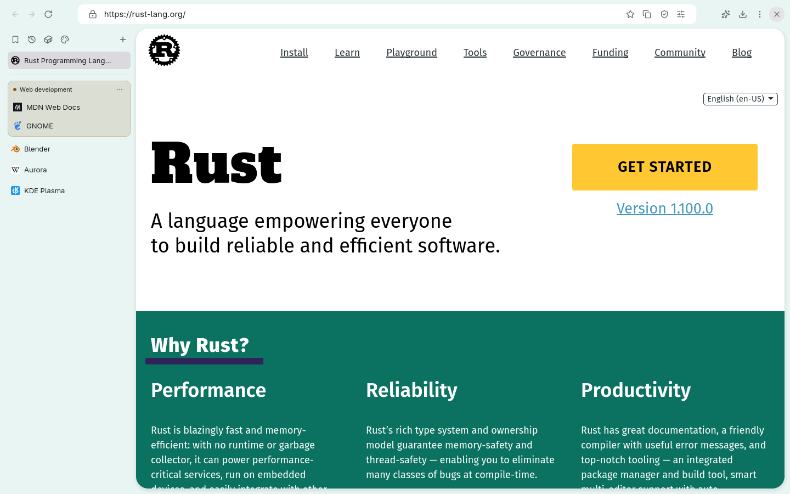
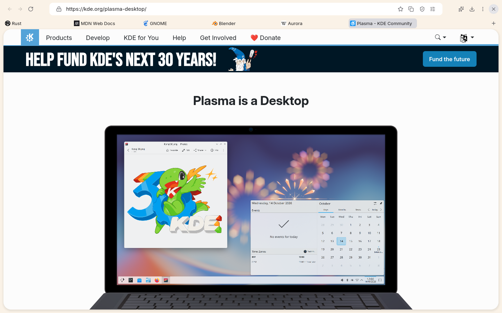
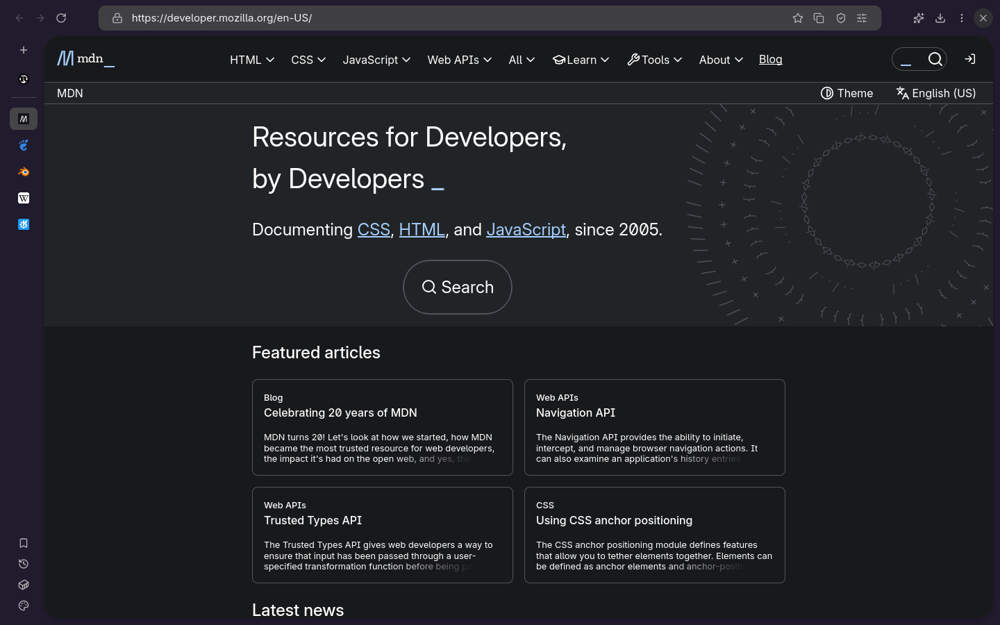
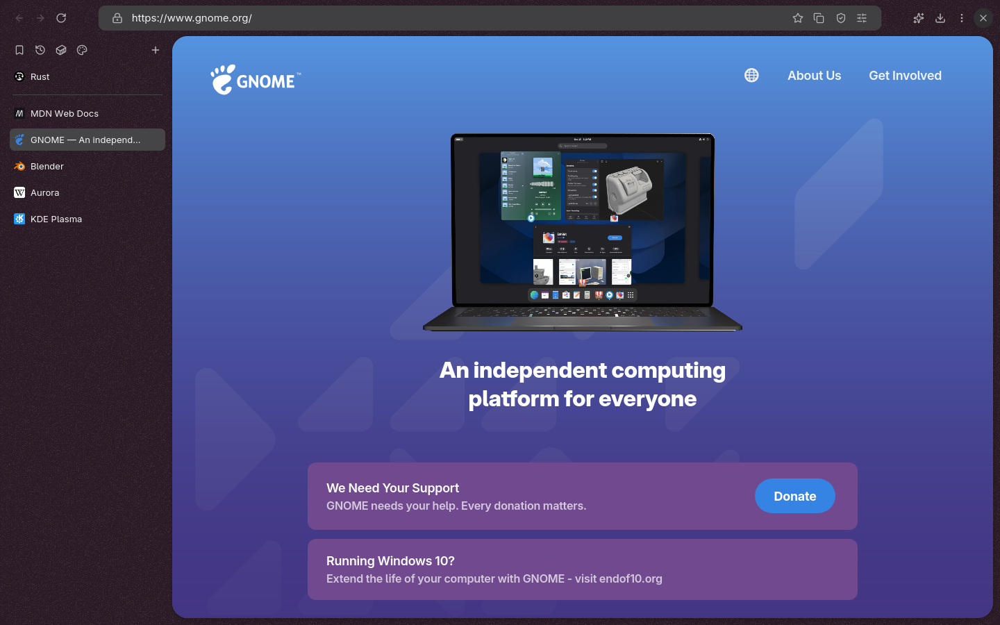
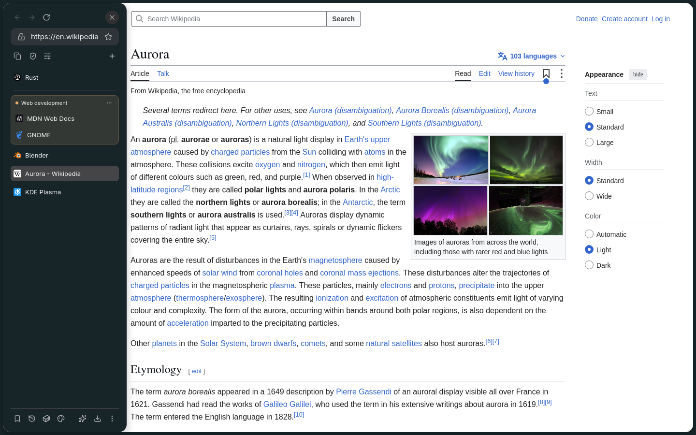
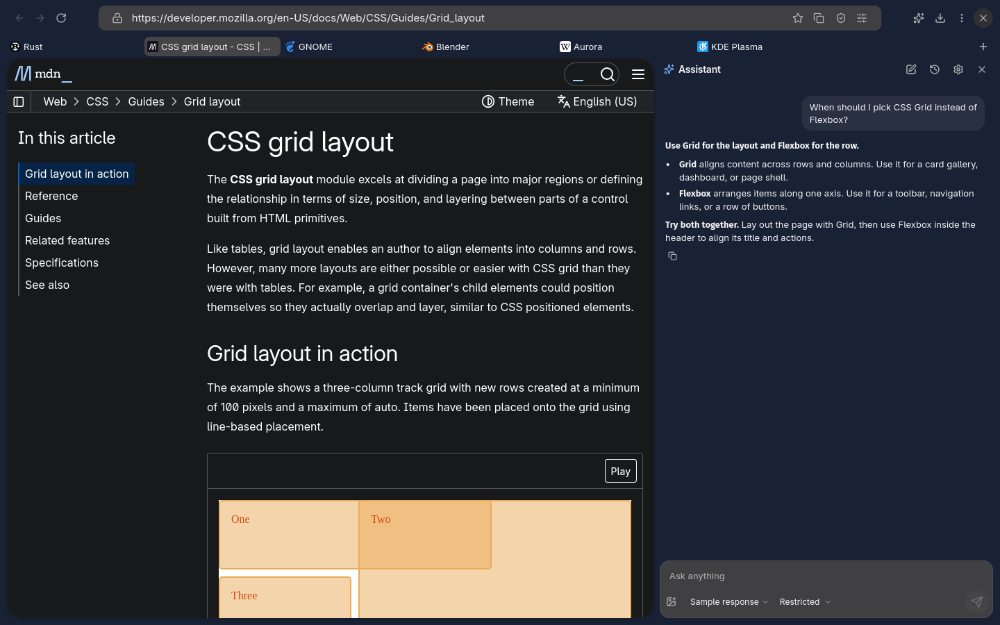
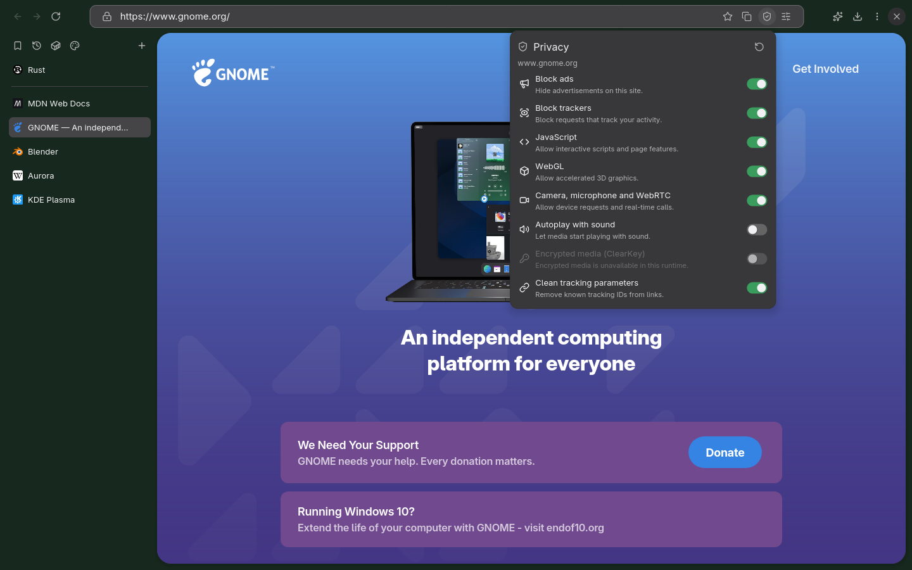
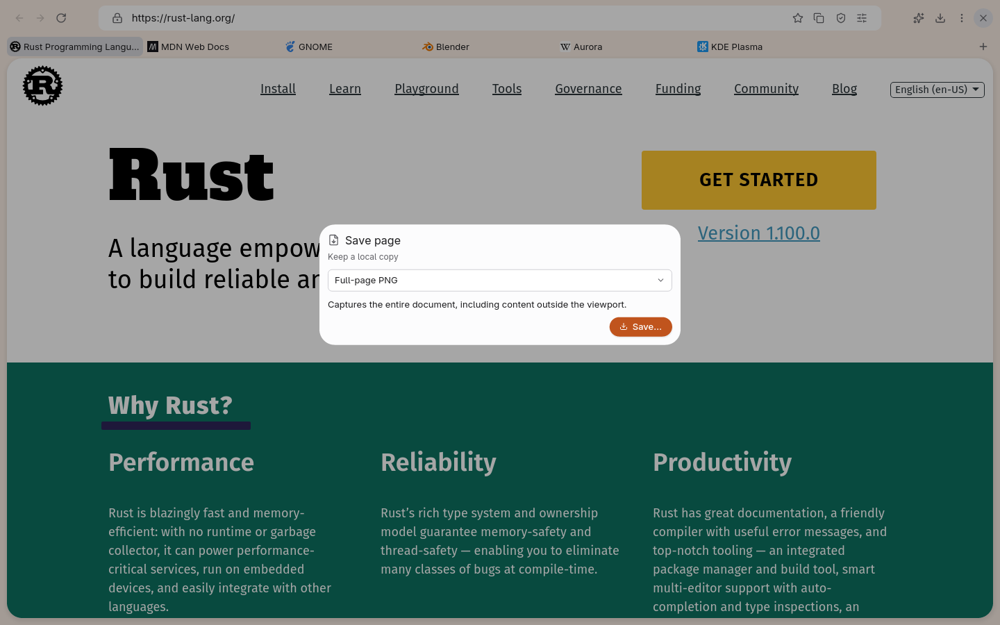

# enzim Browser

A native Linux web browser built with Rust, enzUI, and WPE WebKit. It is in
alpha and intended for development and review.

<table>
  <tr>
    <td align="center"><a href="docs/screenshots/sidebar.webp"></a><br><sub>Sidebar · Light teal</sub></td>
    <td align="center"><a href="docs/screenshots/top-tabs.webp"></a><br><sub>Top tabs · Light amber</sub></td>
  </tr>
  <tr>
    <td align="center"><a href="docs/screenshots/icon-rail.webp"></a><br><sub>Icon rail · Dark violet</sub></td>
    <td align="center"><a href="docs/screenshots/grain.webp"></a><br><sub>Grain frame · Dark rose</sub></td>
  </tr>
  <tr>
    <td align="center"><a href="docs/screenshots/immersive.webp"></a><br><sub>Immersive view · Dark teal</sub></td>
    <td align="center"><a href="docs/screenshots/assistant.webp"></a><br><sub>Assistant · Dark blue</sub></td>
  </tr>
  <tr>
    <td align="center"><a href="docs/screenshots/privacy.webp"></a><br><sub>Site privacy · Dark green</sub></td>
    <td align="center"><a href="docs/screenshots/capture.webp"></a><br><sub>Page capture · Light orange</sub></td>
  </tr>
</table>

Click a screenshot to enlarge. The Assistant shows a sample conversation.

## What you can do

- Arrange tabs across the top or in a sidebar. Pin and group tabs, or use
  immersive mode to give the page more room.
- Separate browsing with named profiles, private windows, and containers.
  Manage per-site permissions, cookie storage, and content blocking.
- Save and fill logins with the encrypted browser vault, desktop keyring, or
  Bitwarden. Import bookmarks, history, and passwords from supported browsers.
- Open PDFs and local documents, manage downloads, and use developer tools.
  Capture an entire web page as PNG or export it as PDF, HTML, or MHTML.
- Open the optional Assistant beside a page or connect the browser to the
  enzUI Agent Center with per-function consent.

[Features and shortcuts](docs/features.md) ·
[Appearance](docs/appearance.md) ·
[Privacy and storage](docs/PRIVACY-DESIGN.md) ·
[Alpha limitations](docs/alpha-status.md)

## Privacy and content blocking

- Balanced protection blocks ads and trackers by default. WebKit filters
  matching network requests using built-in lists including EasyList and
  EasyPrivacy. Cosmetic rules hide supported on-page ads.
  Strict mode extends blocking to first-party requests.
- Open the shield to adjust ad, tracker, and other privacy controls for a
  website. The browser also supports tracking prevention, third-party cookie
  blocking, and tracking-parameter cleanup.
- Use containers to separate site storage. Private windows keep their history
  and sessions temporary. Files you explicitly download or export stay on disk.

See the [privacy and filtering guide](docs/PRIVACY-DESIGN.md) for details.

## Install the Flatpak

Add the enzim Apps remote and install Browser on an x86-64 Wayland desktop:

```sh
flatpak remote-add --user --if-not-exists enzimos https://flatpak.enzim.dev/enzimos.flatpakrepo
flatpak install --user enzimos org.enzim.Browser
```

Flatpak installs the WebKit Platform from the same remote. Browser is an
alpha release. See the [Flatpak build guide](docs/development.md#build-the-flatpak)
if you need to rebuild the package.

## Build from source

Use a Linux desktop with Wayland and a systemd user manager, Rust 1.95 or
newer, Python 3, a C toolchain, and `pkg-config`. Install the development
libraries for enzUI, libcurl, OpenSSL, and SQLite. The prebuilt WebKit runtime
and development SDK are qualified for Arch Linux x86-64.

From a workspace directory, clone the browser and the SDK launch tools:

```sh
git clone https://github.com/enz1m/enzim-browser.git apps/enzim-browser
git clone https://github.com/enz1m/enzim-webkit-rs.git enzui-webkit
git -C enzui-webkit checkout --detach dd5cf6c44ab478d57fc85ad5a383e00442782584
```

[Verify and unpack the WebKit v0.1.1 archives](docs/development.md#prepare-the-native-runtime)
into `enz_browser-deps/` beside `apps/` and `enzui-webkit/`. Then build and run:

```sh
cd apps/enzim-browser
python3 tools/prepare_bitwarden.py
cargo fetch --locked
../../enz_browser-deps/enzim-webkit-sdk-v0.1.1-archlinux-x86_64/bin/enzim-webkit-env ./tools/build
./tools/browser https://example.org/
```

Cargo fetches the Rust dependencies from the public revisions recorded in
[DEPENDENCIES.json](DEPENDENCIES.json). See the [development guide](docs/development.md)
for focused checks and desktop registration.

## Launch options

```sh
./tools/browser ./report.html ./document.pdf
./tools/browser --private-window
./tools/browser -P
./tools/browser --create-profile Work
./tools/browser --profile Work https://example.org/
```

[All documentation](docs/README.md) ·
[Contributing](CONTRIBUTING.md) ·
[Changelog](CHANGELOG.md)

The application is [MIT licensed](LICENSE). Bundled filter inputs, connectors,
and native dependencies have separate [third-party notices](THIRD_PARTY.md).
