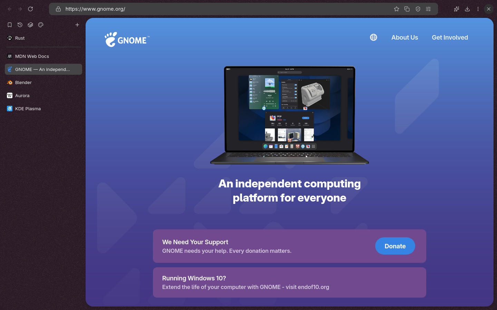

# Appearance



The palette button beside Bookmarks, History and Containers opens the
Appearance popup. It is also **Appearance** in the browser menu and
**Customise…** under Settings, and it is a dialog where no sidebar is shown
(tabs on top, or a window too narrow for a sidebar).

Every choice shows at once and is saved a moment after the last change. The
popup hangs beside the tab strip, where the strip was when it opened, so the
strip stays in view while its sizes change and no slider moves under the
pointer that drags it.

| Choice | Theme token | Range | Without a choice |
| --- | --- | --- | --- |
| Mode: auto, light, dark | `mode` | | the desktop's |
| Colour theme: seven, or the desktop's | the accent roles and the tinted neutrals of `palette`, for both modes (see below) | | the theme's |
| Window frame: solid, grain, glass | `window.frame`, `grain.intensity`; for glass also the browser's own `[browser.glass]` (see below) | grain 2–10 %, 5 % when first chosen | solid |
| Corners | `window.radius` | 0–32 px | the theme's; on Hyprland the desktop's (see Window corners) |
| Top bar height | `sizing.toolbar_height` | 50–84 px | 61 px |
| URL bar height | the browser's own `[browser.address]` (see below) | 30–50 px at the baseline text size | 36 px there |
| URL bar width | the same table | 40–100 % | 95 % |
| Sidebar width | `sizing.sidebar_width` | 180–360 px | 224 px |
| Icon rail width | `sizing.sidebar_min_width` | 44–76 px | 48 px |
| Tab height | `sizing.sidebar_row_height` | 26–44 px | 32 px (28 px on top) |

The reset button at the top of the popup gives every choice back.

## The file

Choices are kept in the browser's own theme file,
`$XDG_CONFIG_HOME/enzui/org.enzim.Browser.toml` (`~/.config/enzui/` by
default). It is an ordinary enzUI theme file laid over the desktop's
`theme.toml` beside it: it may be written by hand or by a theme editor, it may
set any token of the theme schema, and the browser follows it while running.
Every window of every profile reads the same file.

The popup changes only the keys of the choices that were changed in it. Other
keys, comments, and values written by hand stay as they are: a size outside
the popup's range, a grain of another strength. Palette colours that no colour
theme wrote are shown as they are, with no theme marked as chosen, and are
replaced as a whole once a theme is chosen. A file that cannot be read as a theme is reported in the popup and
is not overwritten.

The four sizes are the browser's own where no theme file sets them, because
the schema's defaults describe the framework's shell, not this window. A value
in a theme file moves the chrome once it differs from the schema default; the
popup writes a value that happens to equal the default 0.05 px off it, and
sizes are rounded to whole pixels where they are used.

## Colour themes

A colour theme is an accent and a tint: Blue, Teal, Green, Amber, Orange, Rose
and Violet, each with a deeper accent for the light mode and a brighter one for
the dark. The frame, the surfaces on it, their edges, fields and plain buttons
keep their lightness and move a little from grey towards the accent's hue
(OKLab chroma 0.016; in the light mode less the nearer a colour is to white,
which stays white). Text colours are not changed. A glass frame carries the
same tint.

The grey circle gives the colours back to the desktop's theme. There is no
free colour choice: an accent needs neutrals made for it, and a theme file
written by hand can still name any palette.

The file holds a theme as its twenty palette colours for each mode
(`background`, `surface`, `surface_alt`, `surface_elevated`, `surface_hover`,
`surface_selected`, `selected`, `border`, `border_strong`, `field`,
`field_border`, `field_border_strong`, the three `button_primary_*` fills, and
`accent`, `accent_hover`, `accent_pressed`, `accent_soft`, `focus_ring`). The
popup marks a theme as chosen when the file holds exactly its colours.

## The URL bar

The address bar's height and width are the browser's own, not tokens of the
theme schema; the file keeps them beside the glass values:

```toml
[browser.address]
height = 52
width = 70
```

- **Height** is in pixels. The range and the bar's own height follow the
  desktop's text size, as the field does: 30 to 50 with 36 its own at the
  baseline, 34 to 56 with 41 at a text scale of 1.125. The text and the icons
  in the bar keep their size. The top bar grows with a taller bar, and a top
  bar height chosen lower than the bar needs gives way to it.
- **Width** is the bar's share of the room between the buttons on its two
  sides. Below 100 % it stands in the middle of that room, and what is left
  beside it is the top bar's, to drag the window by. The list of suggestions
  is narrowed with it, down to 420 px. In a window under 640 px wide, where
  the bar has a row of its own, it keeps the row.

The framework's text field comes in three heights only. At the height of its
large field (40 px at the baseline) the bar is that field; at any other, its
own included, the browser draws the bar's body itself around the tallest
field that fits, and shows the pointer over it with
the field's own edge. The faint tint a focused field takes is not drawn then.
A size written by hand outside its range is passed over, and one written into
`[browser.address]` or `[browser.glass]` alone shows at the next change of the
theme proper or the next start, since the framework reports only those.

## Window corners

On most desktops a window that draws its own frame rounds its own corners, and
the Corners choice is their radius. Hyprland rounds every window itself: it
clips the window along its `decoration:rounding` curve and draws the window's
shadow outside that curve. A window that rounded itself there as well left
pixels that were neither window nor shadow, with the bare desktop in them: a
dotted line along the corner where the two radii agreed (the two curves are
smoothed differently) and a sliver where they did not.

On Hyprland the browser therefore asks the compositor for its rounding
(`decoration:rounding` and `decoration:rounding_power`, over its command
socket) and leaves the corner to it:

- the frame is painted to its square corners, and the compositor's curve is
  the window's, squircles included;
- what sits with the corners inside the window (the page's card, dialogs, the
  rim of light on a glass frame) takes the compositor's radius;
- the popup shows "Set by the desktop" in place of the Corners slider;
- where Hyprland is set to round nothing the window is square, and the slider
  sets the radius of what is drawn inside it.

The answer is asked for when the window opens, whenever the theme is read
again and when the popup opens; a rounding changed in between shows from then
on. A window rule that rounds this one window differently is not reported by
the compositor, and a fullscreen window, which Hyprland does not round, keeps
the rim of light of a rounded one.

## Glass

A glass frame is see-through: the top bar and the sidebar show what is behind
the window. Pages, fields, popups and dialogs stay opaque. How much of glass it
is depends on what the desktop does behind a window, which the browser finds
out once for each window, when its frame first is glass:

| The compositor | What the frame is | Where |
| --- | --- | --- |
| paints enzUI's material (`enzui-material-v1`) | the framework's glass, sampled, bent at its edges and lit by the compositor, tinted with the frame's colour | the enzimOS shell |
| blurs behind a region a window names (`ext-background-effect-v1`, or KWin's `org_kde_kwin_blur`) | the blurred desktop under the frame's colour, with the light on the glass painted by the browser | Hyprland, KDE Plasma |
| does neither | the same painting over a sharp desktop | sway, GNOME |

The browser asks for blur behind the frame's own rounded shape, so nothing is
blurred outside its corners, and withdraws the request when the frame is no
longer glass. Where Hyprland cuts the corners the shape keeps a pixel inside
its curve: Hyprland draws blur under all of the edge it smooths, where the
window's shadow belongs, and a bright desktop showed there as a ring. How strong the blur is stays the desktop's setting
(`decoration:blur` in Hyprland, the Blur effect in Plasma): an application
cannot set it, and it never sees the pixels behind its window, so the bending
of light at a glass edge exists only where the compositor paints the material.

What the browser paints itself, where the compositor does not: the frame's
colour as a tint; a rim of light along the window's edge, brightest at the top
left; and a sheen that falls off down the frame.

With a glass frame the popup offers, under the three levels:

| Choice | Range | Clear | Regular | Frosted |
| --- | --- | --- | --- | --- |
| Tint: how much of the frame's colour covers what is behind | 20–95 % | 50 % | 68 % | 84 % |
| Edge light | 0–100 % | 75 % | 60 % | 45 % |
| Shine | 0–100 % | 55 % | 45 % | 30 % |

Choosing a level takes that level's values again. Where the compositor paints
the material, the level is the framework's material of that name; the tint
nobody chose is the material's own (90 % on a dark frame, at least 55 % on a
light one, so the theme's ink reads on it), Edge light scales the material's
highlight, and Shine is not offered. The popup says which of the three kinds
of desktop it found.

These three values are the browser's own, not tokens of the theme schema. The
file keeps them in a table other readers of the file pass over:

```toml
[browser.glass]
tint = 0.4
edge = 0.9
shine = 0.6
```

Compositor support determines whether the window can use blur. Hyprland and
KWin expose different blur protocols, and the enzimOS shell can supply window
material directly. See [visual checks](development.md#native-and-visual-checks)
for the display configurations to cover when changing window rendering.

## Limits

- Text size is not offered. The framework's controls follow the theme's
  `typography.text_scale`; the browser's own labels do not yet.
- The preview of a choice that gives a token back to the desktop (the monitor
  swatch, reset) follows the file, a fraction of a second later than the
  others.
- The sizes are tokens other enzUI applications read from their own theme
  files, not from this one.
