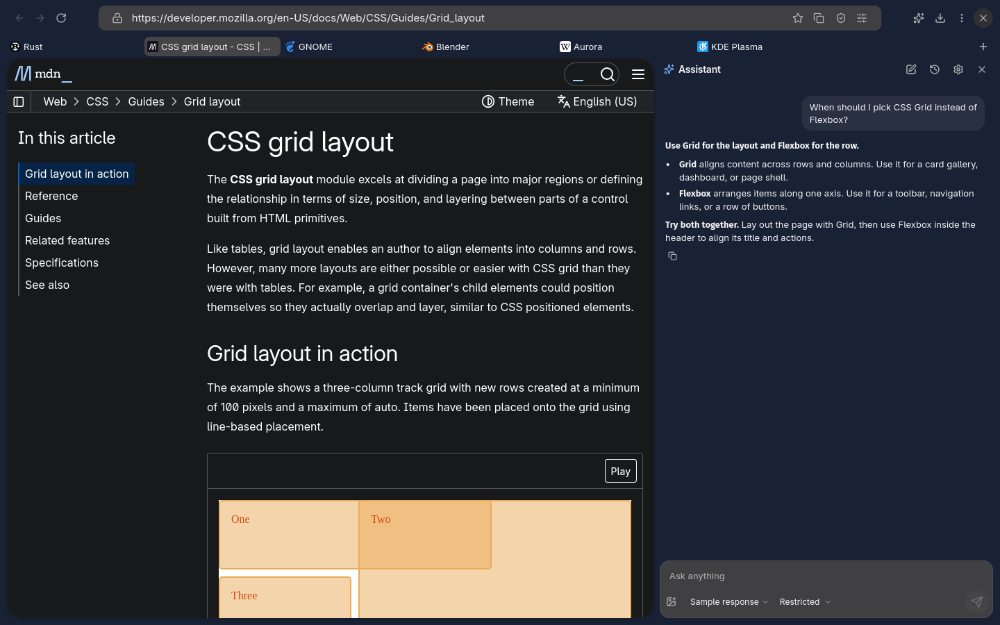

# Assistant

A chat in the window's frame, beside the page, on the side away from the tabs
(with tabs on top, on the side chosen in Settings). Open it with the sparkles
button in the toolbar or Ctrl+Shift+A; it slides in and out beside the page.
Drag its inner edge to resize it. In a window narrower than 760 pixels it takes
the page's place until it is closed. The message field grows with what you type,
wrapped lines included, up to eight lines. Its bottom row holds the picture
button, the model (the row shows the part after the last `/`, so
`vendor/model` reads `model`; see Models), what the assistant may do
without asking, and Send. While it answers, a line above the field says what it
is doing (Thinking, Writing, the function it runs) with a moving highlight, and
for how long. Once the answer is written the field is ready again: reply
suggestions and link cards still being prepared appear when they are done, and a
message sent meanwhile starts the next turn after them. Everything in the conversation can
be selected and copied.
It is not offered in private windows.

## Models

Settings → Assistant → Model services lists the services, each with change and
remove, and the ChatGPT sign-in. **Add service** opens a dialog: a name, the
address (OpenAI, OpenRouter, Ollama and LM Studio fill it in) and the API key.

- **Services with an API key**: any OpenAI-compatible service
  (`{address}/chat/completions`, streamed), such as OpenAI, OpenRouter, or a
  local server, which needs no key. Each key is kept in the desktop keyring
  (record `assistant-api-key-{id}`; a service from before the list keeps
  `assistant-api-key`), never in the profile's files; removing a service
  removes its key.
- **ChatGPT**: sign in with a ChatGPT plan. The sign-in page opens in a tab;
  the browser listens on a loopback port (1455, or any free one) for the
  return, lets that tab reach this one loopback address (public pages may not
  reach local ones otherwise) until the sign-in ends, exchanges the code
  (PKCE) and keeps the tokens in the desktop keyring
  (record `assistant-chatgpt`). OpenAI may refuse the first code of a new
  registration (`invalid_grant`); the browser then keeps the client id it was
  issued and sends the same tab through the sign-in once more. Requests go to the plan's Responses API,
  streamed and not stored; the conversation is translated to and from it.

The model under the message field opens a menu of the services; the one under
the pointer shows its models beside it (read from the service when first
shown), the one in use first, in a list that scrolls and filters as you type.
A name the list lacks can still be used. Choosing a model also chooses its
service; each service remembers its model.

Replies arrive a paragraph at a time rather than per token; a long paragraph
still shows about once a second. Reasoning, when the model sends it, is a
closed "Thought" row.

## System prompt

Settings → Assistant → System prompt → **Edit…** opens what the model is told
before every chat, to change. **Restore default** puts the browser's own back;
saved unchanged (or empty), the browser's own is used, including its later
versions. Up to 20,000 characters. Each message still names the tab you are
on, and with **Use other apps** on a sentence about them follows the prompt.

## What it can do

Each message tells the model which tab you are on and names up to ten other
tabs of the window (page id, title, address), leaving out browser pages and
containers closed to agents. The model has:

- the browser's own functions, the ones agents use through the agent center
  (see [agents](agents.md)): list tabs, windows and containers, read a page
  (`take_snapshot`), look at it (`take_screenshot`), open, switch, navigate and
  close tabs, click, type, fill forms, scroll, run a script, answer dialogs;
- `web_search`: up to six results (title, address, snippet) from
  DuckDuckGo's plain results page, fetched like `read_web_page`; the search
  words go to DuckDuckGo;
- `read_web_page`: the text of a public web page, without a tab, cookies or
  sign-ins, to check a link or look something up;
- `show_links`: link cards with a preview of each page;
- `suggest_replies`: up to four reply buttons under the answer (a model that
  writes `<suggest_replies>` or `<show_links>` into its answer instead of
  calling them gets the same buttons or cards, and the tag is not shown);
- with **Use other apps** on, the agent center's four tools, to use other apps;
- with **Memory** on, `remember`, `forget` and `search_chats` (see Memory).

It works beside you rather than in your tab: looking things up goes through
`web_search` and `read_web_page`, which open no tab. A tab of yours that is not
loaded would have to be shown to load, so reading it gives the text at its
address instead, and acting on it is refused.

Private windows and containers whose **Allow agents** is off are out of its
reach, as they are for agents.

What it may do without asking is chosen in the message field's bottom row or in
Settings → Assistant → Access to pages. Reading the tab you are on never asks.
At every level, reading or acting on another tab asks, and so does a web
search, a page fetch, opening an address or running a script once the chat
holds page content, since the address the model chose could carry it away.
Each message names only the sites of your other tabs, not their titles or
addresses.

- **Restricted** (the default): every function that changes something
  (opening, closing or switching tabs, navigating, clicking, typing, running
  scripts) waits until you choose Allow, Allow for this chat or Deny.
- **Moderate**: anything on the tab you are on runs; opening, closing or
  switching tabs and windows, and acting on other tabs, ask.
- **Full access**: nothing asks.

A service that answers that it is busy or rate limited is asked again up to
three times (after 3, 8 and 20 seconds) while the line above the field says
so, as long as nothing of the answer has arrived.

Small models wander, so a turn has three guards that never stop it:
- **Repeated calls:** a function called a third time running with the same
  arguments is answered with a request to use what it returned.
- **Reminders:** every 12 function calls, the browser adds a note asking the
  model to answer with what it has or say what is missing.
- **Announced steps:** a reply whose last sentence only announces a step
  ("Let me take a snapshot.") is answered once with a request to make the
  call or give the answer.

Filling a form field by its label's uid fills the field the label is for;
filling or clicking a list option's uid chooses it (a closed list's option
has no place to press); an option may be named in another case or inside a
longer text ("Pro plan"). These hold for agents in the agent center too.

A turn has no step or time limit: it goes on until the model answers without
calling a function, or with only reply suggestions or link cards, or you press
Stop. Waiting for one function's result or
your approval gives up after 15 minutes. Its steps fold into one line per run; open a step to see what it sent and got
back, including the picture when it looked at a page.

## Links, pictures and steering

- Links in a reply get a preview button unless **Link previews** is off; a
  site learns of the link only when you ask for its preview card (title,
  description, site, picture). Previews and `read_web_page`
  fetch only public addresses: the name is resolved first, every address must
  be global, the connection is pinned to it, and redirects are checked the same
  way. Nothing but a plain GET is sent.
- Paste a picture into the message field, or choose pictures on the computer
  with the picture button, which opens the desktop's file chooser (PNG, JPEG,
  WebP, GIF or BMP, up to 40 MB each);
  up to four go with a message. The assistant takes its own pictures of pages
  when it needs them.
- Typing while it answers steers the answer: the message reaches the model
  before its next step. Stop ends the turn at once.

## Chats

Each chat is saved when a turn ends, as one file in the profile's
`assistant-chats` folder (`$XDG_CONFIG_HOME/enzim-browser/assistant-chats`,
readable only by you). Its title is the start of its first message. Pictures
are not kept: the saved conversation and transcript say where one was. The
history button between New chat and Settings lists the chats, newest first;
one opens in the panel and can be continued, and the bin, shown on the row
under the pointer, deletes one. Opening
another chat stops a turn that is running and saves the chat as it stands.
Private windows have no assistant, so nothing of theirs is saved.

## Memory

Off by default. Settings → Assistant → **Memory** lets the assistant keep short
notes between chats: lasting facts you share or ask it to remember, at most 300
characters each and 2,000 in all, kept in the profile's settings and listed
under the switch, where each can be forgotten. The notes, with how much of the
space they use, go near the top of the system message of every turn;
`remember` adds a note and `forget` removes the one containing a given text (a
note that would not fit is refused with the notes listed, so the assistant
tidies them first). Small models call two plainly named functions more
reliably than one with an action. `search_chats`
finds earlier saved chats by their words and returns their dates and short
excerpts. The design follows Hermes Agent's bounded memory: a small curated
block in the prompt and a word search over past chats, with no second model.

## Other apps

With the enzUI agent center installed (`enzui-mcp` on the `PATH`), **Use other
apps → Connect** enrolls the assistant as the agent
`org.enzim.Browser.Assistant`, with its credential in
`$XDG_CONFIG_HOME/enzui/agents/` (a private folder). While on, a turn starts
`enzui-mcp` and offers its tools; the center asks you before each app function
runs, and the panel shows that it is waiting. The browser itself is left out of
the app list: its functions are the assistant's directly.

## Resources

Off, the assistant takes nothing. On but unused, it is a toolbar button: the
chat is made when the panel first opens. A turn's thread, connection and agent
center adapter exist only while it answers; the only timer is a once-a-second
clock while a turn runs and the panel is open. Saved chats are read only
when the list or a chat is opened.
